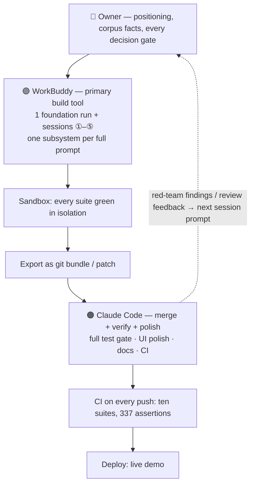

# multi-agent-workflow

A [Claude Code](https://claude.com/claude-code) skill that encodes a **two-agent collaboration workflow validated in a real hackathon**: one agent writes, the other verifies, the human decides.

```
👤 Owner     — positioning, facts, every decision gate
🟣 WorkBuddy — builds one subsystem per prompt in a sandbox (Tencent Cloud)
🟠 Claude Code — merges, runs the full test gate, polishes UI/docs/CI
```

## Workflow



High-res flowchart (1920×1080, with the full example annotations): [docs/workflow-1920x1080.png](docs/workflow-1920x1080.png) · portrait version (1080×1440): [docs/workflow-1080x1440.png](docs/workflow-1080x1440.png)

## Where it came from

Built and battle-tested on **Meridian Pay — Enterprise Knowledge Brain**, a solo submission to the Tencent Cloud AI CAN DO IT Hackathon 2026 (FinTech track, Aspire challenge).

- **1 person · 2 weeks** (foundation run 9/26 → submission 10/16)
- Test growth: **9 → 337 assertions** across ten suites, CI on every push
- Gold-standard RBAC tests: leak = 0, recall = 100%
- 26-check red-team suite (injection, role forgery, multi-hop puzzles)
- Live demo + 5:57 video

Full project: [summersalt827/meridian-pay-kb](https://github.com/summersalt827/meridian-pay-kb) · docs: [AI-COLLABORATION.md](https://github.com/summersalt827/meridian-pay-kb/blob/main/docs/AI-COLLABORATION.md)

## Install

```bash
mkdir -p ~/.claude/skills/multi-agent-workflow
cp SKILL.md ~/.claude/skills/multi-agent-workflow/
```

Then say "多agent协作" (or describe a two-agent workflow) in Claude Code to invoke it.

## What's inside

- **3-role division** with explicit red lines per role
- **6-step iteration loop**: session prompt → sandbox build → bundle export → merge → test gate → CI/deploy → feedback loop
- **5 hard-won rules**, including a real incident: an intentional design (OOV-aware score ceiling) was "fixed" as a bug by the other agent and broke all 21 calibration cases (irrelevant score 0.15 → 0.73)
- Deliverables checklist for a demonstrable dev-process story (session prompts, screenshots, honest collaboration doc, test-growth numbers)

## License

MIT
